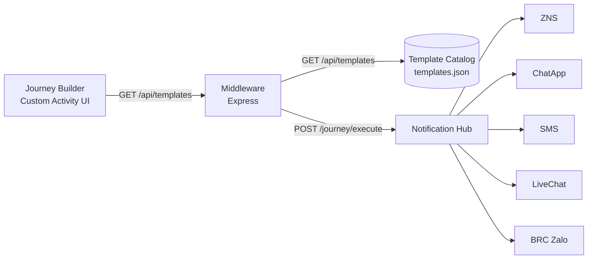

# Software Requirements Specification (SRS) — Notification Hub Template Catalog API

| Field | Value |
|---|---|
| Document ID | SRS-NHT-001 |
| Version | 1.6 |
| Status | Approved |
| Date | 2026-10-26 |
| Author | Business Analyst |
| Product | Salesforce Marketing Cloud Custom Activity — Notification Hub middleware |
| Related docs | [BRD — Notification Channels](./notification-channels-brd.md), [Data Dictionary](./template-catalog-data-dictionary.md), [RTM](./requirements-traceability-matrix.md) |

---

## 1. Introduction

### 1.1 Purpose

This document specifies the functional and non-functional requirements for the **Template Catalog API** exposed by the Notification Hub middleware. The API serves the Notification Hub template catalog to the Salesforce Marketing Cloud Journey Builder Custom Activity UI so journey designers can select a template, map Data Extension fields to its parameters, and send notifications through the Notification Hub.

### 1.2 Scope

In scope:

- `GET /api/templates` — list the template catalog.
- `GET /api/templates?channel=<code>` — filter the catalog by notification channel.
- The canonical **channel taxonomy** (corrected channel list) consumed by this API.
- Validation rules and error semantics of the API.

Out of scope (documented for context only):

- The Notification Hub's own internal template-registration API (the middleware consumes it later).
- Channels managed by Insider (**App Push**, **In App**) — owned by a different team.
- The `/journey/execute` payload-delivery flow (separate SRS).
- Authentication/authorization of the API itself (handled by the hosting platform).

### 1.3 Audience

Business analysts, product owners, backend developers, frontend developers, QA engineers, and the Notification Hub integration team.

### 1.4 Definitions, Acronyms, Abbreviations

| Term | Definition |
|---|---|
| Notification Hub | Central notification platform that renders and delivers templates across channels (ZNS, Chat App, SMS, Live Chat, BRC). |
| Template | A registered message blueprint with a `templateKey`, channel, content, addresses, recipient fields and parameters. |
| Channel | A delivery medium for notifications (e.g. ZNS, ChatApp, SMS). |
| ZNS | Zalo Notification Service — transactional template messages delivered to Zalo users addressed by phone number. |
| ChatApp | Rich-media chat messages sent through the Zalo Official Account (image, title, content, URL, buttons). |
| BRC | Brand Representative Chat — Zalo messaging used for broadcast/CRM conversations on the Official Account. |
| OA | Zalo Official Account. |
| Custom Activity | A Salesforce Marketing Cloud Journey Builder extension that calls a third-party endpoint (`/journey/execute`). |
| Data Extension | Salesforce Marketing Cloud data store whose fields are mapped to template parameters. |
| MoSCoW | Prioritization method: Must have, Should have, Could have, Won't have. |

### 1.5 Regulatory and Standards References

| Reference | Relevance |
|---|---|
| Vietnam Decree 13/2023/ND-CP (Personal Data Protection) | Template payloads carry customer PII (phone, name) and health-related data (vaccination reminders, medication refills). Recipient data handling must comply with PDPD consent, minimization and security obligations. |
| Vietnam Law on Cybersecurity 24/2018/QH14 | Protects customer data processed by the middleware. |
| Decree 91/2020/ND-CP (advertising via SMS/email/calls) | Governs commercial notification content sent over SMS and similar channels; opt-out and sender identification apply. |
| Zalo ZNS / Zalo OA platform policies | Template registration, content approval and sending quotas imposed by Zalo for ZNS, ChatApp and BRC channels. |
| Salesforce Marketing Cloud Journey Builder Custom Activity spec | Defines the `inArguments`, save/load and execute contract the UI must satisfy. |
| ISO/IEC 25010 (SQuaRE) | Quality characteristics referenced for NFRs (performance, reliability, usability). |

---

## 2. Overall Description

### 2.1 Product Perspective

The middleware sits between Salesforce Marketing Cloud Journey Builder and the Notification Hub:

For the MVP the catalog is read from `server/data/templates.json`. Later the repository is swapped for a Notification Hub client without changing the API contract.

### 2.2 Users and Personas

| Persona | Description | Needs |
|---|---|---|
| Journey Designer | Marketing user who builds journeys in Salesforce MC | Browse templates by channel; see template content and required parameters. |
| Integration Engineer | Builds/maintains the middleware | Stable API contract; clear error semantics; extensible channel list. |
| QA Engineer | Verifies behavior | Deterministic fixtures; measurable acceptance criteria. |

### 2.3 Operating Environment

- Server: Node.js (Express) middleware deployed as a container.
- Client: Browser-based Custom Activity UI (ES modules, fetch).
- Data source: local JSON catalog (MVP); Notification Hub API later.

### 2.4 Assumptions and Dependencies

- The Notification Hub has **no public template API today**; the JSON file is the interim source (README §5).
- Channel codes are case-insensitive and tolerant of display-name aliases.
- Template payloads from the business register **one recipient per execute call** (confirmed by 146/146 sample payloads).
- The channel list must remain **extensible without UI changes** (README §1, goal 4).

---

## 3. Functional Requirements

### 3.1 Endpoint: List Templates

#### FR-TPL-001: Return the full template catalog

**Priority**: Must Have
**Status**: Approved (existing behavior)

**Description**

The API MUST return every template in the catalog as a JSON object with an `items` array.

**Functional Requirements**

- **FR-TPL-001.1**: `GET /api/templates` MUST respond with HTTP `200` and body `{ "items": [ ... ] }`.
- **FR-TPL-001.2**: Each item MUST contain `templateKey`, `displayName`, `channel`, `version`, `content`, `addresses`, `recipientFields` and `params` conforming to the [Data Dictionary](./template-catalog-data-dictionary.md).
- **FR-TPL-001.3**: The `channel` field in the response MUST be a canonical channel **code** (see FR-TPL-005).

**Acceptance Criteria**

1. `GET /api/templates` returns HTTP 200 with `Content-Type: application/json`.
2. `items` is an array; every element passes the client-side shape check (`isTemplateLike`): `templateKey`, `displayName`, `channel` are non-empty strings; `addresses` and `params` are arrays; `content` is a string when present.
3. The catalog contains at least the 8 MVP templates shipped in `server/data/templates.json`.

---

#### FR-TPL-002: Filter templates by channel

**Priority**: Must Have
**Status**: Approved (existing behavior)

**Description**

The API MUST filter the catalog by a single channel using the `channel` query parameter. The parameter MUST accept a canonical code or any registered display-name alias (e.g. `ZNS`, `zns`, `Zalo`).

**Functional Requirements**

- **FR-TPL-002.1**: `GET /api/templates?channel=<value>` MUST return only templates whose channel equals the resolved code.
- **FR-TPL-002.2**: Channel resolution MUST be case-insensitive and MUST ignore spaces, underscores and hyphens (`ZNS` ≡ `zns` ≡ `Z-N-S`).
- **FR-TPL-002.3**: When the channel value resolves to no known channel, the API MUST respond HTTP `400` with body `{ "message": "Unsupported channel: <value>" }`.
- **FR-TPL-002.4**: An empty, null or missing `channel` parameter MUST be treated as "no filter" and return the full catalog.

**Acceptance Criteria**

1. `GET /api/templates?channel=ZNS` returns only templates with `channel === "ZNS"`.
2. `GET /api/templates?channel=zns` returns the same set as criterion 1.
3. `GET /api/templates?channel=DoesNotExist` returns HTTP 400 with a `message` field.
4. `GET /api/templates?channel=` returns the full catalog (HTTP 200).

---

#### FR-TPL-003: Return template details for preview

**Priority**: Should Have
**Status**: Approved (existing behavior)

**Description**

Each catalog item MUST carry enough information for the UI to render a template preview with highlighted `{variable}` placeholders and a mapping screen.

**Functional Requirements**

- **FR-TPL-003.1**: `content` MUST be the message text with variable placeholders in `{name}` form.
- **FR-TPL-003.2**: `params` MUST list every placeholder with `name`, `required` and `type`.
- **FR-TPL-003.3**: `addresses` MUST list the recipient address descriptors (e.g. `phone`) with `name`, `required` and `type`.
- **FR-TPL-003.4**: `recipientFields` MUST list additional recipient attributes (e.g. `customerId`) when the channel requires them.
- **FR-TPL-003.5**: The preview section MUST visually highlight every `{variable}` placeholder inside the rendered content (e.g. `{customerName}`) as a distinct chip, with color reflecting the mapping state: green = mapped (Auto/Manual), red = required but unmapped, amber = ambiguous, gray = optional and unmapped, dashed = not a declared variable. Each chip MUST expose a tooltip naming the mapping target and its status.

**Acceptance Criteria**

1. Every template item renders in the preview UI without unresolved `{...}` tokens beyond its declared `params`.
2. Every declared required param is present in the mapping UI as a mandatory field.
3. Rendering `content` containing `{customerName}` produces a highlighted chip labelled `{customerName}`; the chip is green when a mapping exists for the target and red when the target is required and unmapped.
4. Literal braces that do not match a declared variable render as a dashed "not a variable" chip.

---

#### FR-TPL-004: Validate catalog integrity on load

**Priority**: Must Have
**Status**: Approved (existing behavior)

**Description**

The repository MUST validate every template read from the data source before serving it. Invalid templates MUST NOT be served.

**Functional Requirements**

- **FR-TPL-004.1**: Each raw template MUST pass `findTemplateProblems`: `templateKey` and `displayName` non-empty; `channel` resolvable to a code; `version` a positive integer when provided; `content` a string when provided; `addresses` and `params` arrays of named entries.
- **FR-TPL-004.2**: Templates with an unresolvable channel MUST be rejected (validation error), not silently assigned a channel.
- **FR-TPL-004.3**: On catalog load failure, the API MUST respond HTTP `500` with `{ "message": "Unable to load templates" }`.

**Acceptance Criteria**

1. Removing `templateKey` from a fixture causes the repository test to report a validation problem.
2. Setting `channel` to an unregistered value causes a validation problem naming the supported channels.
3. `GET /api/templates` returns HTTP 500 when the catalog file is missing or malformed.

---

#### FR-TPL-005: Serve the corrected channel taxonomy

**Priority**: Must Have
**Status**: Implemented (ADR-001; MVP catalog and channel registry aligned)

**Description**

The API MUST serve templates using the **corrected canonical channel list** derived from the business template register (see [BRD — Notification Channels](./notification-channels-brd.md)). The current implementation recognizes four codes (`SMS`, `CHATAPP`, `ZALO`, `BRC_ZALO`); the corrected taxonomy replaces the ambiguous `ZALO` code with `ZNS` and adds `LIVECHAT`.

**Functional Requirements**

- **FR-TPL-005.1**: The canonical channel codes MUST be, in priority order:

  | Code | Display name | Status |
  |---|---|---|
  | `ZNS` | Zalo ZNS | Must Have |
  | `CHATAPP` | Chat App | Must Have |
  | `SMS` | SMS | Must Have |
  | `LIVECHAT` | Live Chat | Must Have |
  | `BRC_ZALO` | Zalo BRC / Broadcast OA | Must Have |
  | `APP_PUSH` | App Push | Won't Have (Insider-owned) |
  | `IN_APP` | In App | Won't Have (Insider-owned) |

- **FR-TPL-005.2**: `ZALO` MUST remain a resolvable **alias** of `ZNS` for backward compatibility with existing templates and stored activity configurations. `GET /api/templates?channel=Zalo` MUST behave identically to `?channel=ZNS`.
- **FR-TPL-005.3**: All display-name aliases observed in the business register MUST resolve to their canonical code (see alias table in the BRD §4).
- **FR-TPL-005.4**: `APP_PUSH` and `IN_APP` MUST NOT be served by this API (they are managed by Insider); requesting them MUST return HTTP 400.

**Acceptance Criteria**

1. `GET /api/templates?channel=ZNS` and `GET /api/templates?channel=Zalo` return identical item sets.
2. `GET /api/templates?channel=ChatApp`, `?channel=chat app`, `?channel=chatapp` return identical item sets (all resolve to `CHATAPP`).
3. `GET /api/templates?channel=LIVECHAT` returns templates for live-chat use cases.
4. `GET /api/templates?channel=APP_PUSH` returns HTTP 400 with a message stating the channel is not served by this API.
5. The UI channel dropdown renders the five in-scope channels in the order of FR-TPL-005.1.

---

#### FR-TPL-006: Represent failover strategy without a new channel

**Priority**: Should Have
**Status**: Proposed

**Description**

The business register uses composite labels such as `ZNS/ SMS Failover`, `ZNS fail over`, `zns/sms`. These express a **delivery strategy** (primary channel + fallback channel), not a distinct channel. The API MUST NOT invent a `ZNS_SMS` channel; failover MUST be represented as metadata on the template or the journey configuration.

**Functional Requirements**

- **FR-TPL-006.1**: Composite failover labels MUST resolve to the **primary** channel code (`ZNS` for `ZNS/ SMS Failover`).
- **FR-TPL-006.2**: When a template carries a failover strategy, the catalog item SHOULD expose it via an optional `failover` field (e.g. `{ "channel": "ZNS", "failover": { "channel": "SMS" } }`).
- **FR-TPL-006.3**: The UI MUST display the failover strategy as informational text and MUST NOT treat it as a separate selectable channel.

**Acceptance Criteria**

1. A template registered as `ZNS/ SMS Failover` appears under `?channel=ZNS`.
2. Its catalog item, when present, includes `failover.channel === "SMS"`.
3. No template in the catalog has `channel === "ZNS_SMS"` or any composite code.

---

### 3.2 Error Semantics

#### FR-TPL-007: Consistent error responses

**Priority**: Must Have
**Status**: Approved (existing behavior)

**Description**

All error responses MUST be JSON with a `message` field and the appropriate HTTP status.

**Functional Requirements**

- **FR-TPL-007.1**: HTTP `400` — unsupported channel: `{ "message": "Unsupported channel: <value>" }`.
- **FR-TPL-007.2**: HTTP `500` — catalog load failure: `{ "message": "Unable to load templates" }`.
- **FR-TPL-007.3**: Unexpected server errors MUST be logged server-side; the response MUST NOT leak stack traces or internal paths.

**Acceptance Criteria**

1. Every non-2xx response body is valid JSON containing a `message` string.
2. Logs contain the error detail for 500s; the response body does not.

---

## 4. Non-Functional Requirements

### NFR-TPL-001: Performance

**Priority**: Must Have

- The API MUST respond to `GET /api/templates` in under **200 ms** (p95) for a catalog of up to 500 templates.
- The API MUST support at least **50 concurrent requests/second** without degradation.

### NFR-TPL-002: Availability and Reliability

**Priority**: Should Have

- The API MUST achieve **99.5% availability** during business hours.
- Catalog load failures MUST fail fast (fail-closed) rather than serve a partial catalog.

### NFR-TPL-003: Security and Data Protection

**Priority**: Must Have

- The API MUST NOT log recipient values (phone numbers, names, tokens). Payload logging MUST use the redaction helper (`redactPayload`).
- Customer PII served or referenced by templates MUST be handled per Decree 13/2023/ND-CP (consent, minimization, security).
- The API MUST NOT expose internal configuration, environment variables, or the data-source path in responses.

### NFR-TPL-004: Usability

**Priority**: Should Have

- Channel labels in the UI MUST be human-readable display names (`Zalo ZNS`, `Chat App`, `SMS`, `Live Chat`, `Zalo BRC / Broadcast OA`), not codes.
- The channel dropdown MUST be sorted in the order of FR-TPL-005.1.

### NFR-TPL-005: Maintainability and Extensibility

**Priority**: Must Have

- Adding a new channel MUST require changes only to the channel registry (model + client constant list), NOT to the UI screens, mapping logic, save logic or execute logic (README §1, goal 4).
- The data source MUST be swappable (JSON → Notification Hub) without changing the API contract.

### NFR-TPL-006: Compatibility

**Priority**: Must Have

- The response contract MUST remain backward compatible with the current frontend client (`public/js/services/templateApi.js`).
- Channel alias resolution MUST be backward compatible with stored activity configurations that reference `Zalo`.

---

## 5. Traceability

See [Requirements Traceability Matrix](./requirements-traceability-matrix.md).

---

## 6. Activity Definition (config.json)

**Status**: Implemented (ADR-002; see [SPEC-NHT-003](./activity-config-correction-spec.md))

The service MUST serve a Journey Builder custom activity definition at `GET /config.json` that conforms to the
official Salesforce sample (`sfmc-example-jb-custom-activity`).

**FR-CFG-001**: The definition MUST include a top-level `name` and `description` (in addition to the `lang`
entries), because Journey Builder requires the top-level `name` to register and list the activity.

**FR-CFG-002**: `metaData.category` MUST be `"Custom"` so the activity appears under the Custom group in the
palette.

**FR-CFG-003**: `userInterfaces.configModal` MUST advertise the regional UI entry:
`{ url: "{PUBLIC_BASE_URL}/regional/", height: 700, width: 900, fullscreen: true }`. The service MUST serve the
Custom Activity UI at `/regional/`; without it Journey Builder cannot open the configuration modal.

**FR-CFG-004**: When JWT verification is enabled, `arguments.execute` and every lifecycle endpoint under
`configurationArguments` (`save`, `validate`, `publish`, `stop`) MUST carry
`securityOptions: { securityType: "securityContext", securityContextKey: "<External Key>" }`, with the External
Key taken from `SFMC_SECURITY_CONTEXT_KEY`. The legacy `useJwt` flag MUST NOT be emitted.

**FR-CFG-005**: The definition SHOULD include `copySettings: { allowCopy: true, ignoreArguments: ["eventDefinitionKey"] }`.

**FR-CFG-006**: The definition MUST be served at BOTH `GET /config.json` and `GET /public/config.json`, publicly
(no authentication), with identical bodies and `Cache-Control: no-store`. This supports deployments whose
Marketing Cloud activity endpoint is either the service root or `https://<host>/public`.

**FR-CFG-007**: The definition MUST follow the official sample (`sfmc-example-jb-custom-activity`) exactly:
top-level `name`/`description`; `metaData.category: "Custom"`; `arguments.execute` with example `inArguments`
(defaults for the five fixed keys) and `outArguments` matching the real execute response
(`{ success, status }`); sample timing values (`timeout: 10000`, `retryCount: 1`, `retryDelay: 1000`,
`concurrentRequests: 6`); `securityOptions.securityContext` on execute and all lifecycle endpoints when JWT is
enabled; schema entries in `dataType`/`isNullable`/`direction` form; and `copySettings` with
`ignoreArguments: ["eventDefinitionKey"]`. No `useJwt`, `verb`, or `access` schema keys MUST be emitted.

**Acceptance Criteria**

1. `GET /config.json` returns a definition containing `name`, `category: "Custom"`, `configModal.url` and (when
   JWT is on) `securityOptions` on execute and all lifecycle endpoints.
2. `GET /public/config.json` returns the same body as `GET /config.json` with status 200 and
   `application/json`.
3. After registering the endpoint in Marketing Cloud, the activity appears under **Custom** in the Journey
   Builder palette and its config modal opens.
4. The emitted definition contains no `useJwt`, no `verb`, and no `access` keys in the schema.

---

## 7. Out of Scope (explicit)

- Notification Hub template **registration** (creating templates on the Hub) — the Hub has no public API yet.
- **App Push** and **In App** channels — owned by the Insider team; payloads for these channels are documented in the register but not served by this API.
- Email channel — not present in the current business register; to be added when the register includes it.
- Bulk/broadcast sending logic and delivery receipts.
- Multi-language template rendering.

---

## 8. Revision History

| Version | Date | Author | Change |
|---|---|---|---|
| 1.0 | 2026-10-26 | BA | Initial release; corrected channel taxonomy (FR-TPL-005, FR-TPL-006) from business register analysis. |
| 1.1 | 2026-10-26 | Solution Architect | FR-TPL-005 marked Implemented (ADR-001); added FR-TPL-003.5 preview variable-highlighting requirement and acceptance criteria. |
| 1.2 | 2026-10-26 | Solution Architect | Added §6 Activity Definition (config.json) requirements (FR-CFG-001..005) per ADR-002; renumbered sections 6-7 to 7-8. |
| 1.3 | 2026-10-26 | Solution Architect | Added FR-CFG-006 dual-path exposure (`/config.json` and `/public/config.json`) per SPEC-NHT-004. |
| 1.4 | 2026-10-26 | Solution Architect | Added FR-CFG-007 exact sample alignment (category, securityOptions, schema shape, sample timings) per SPEC-NHT-005. |
| 1.5 | 2026-10-26 | Solution Architect | Amended FR-CFG-003: configModal.url points at the regional entry `{PUBLIC_BASE_URL}/regional/` with height/width/fullscreen per SPEC-NHT-006. |
| 1.6 | 2026-10-26 | Solution Architect | Implementation verified: HANDOFF-001 executed by the build agent; 34 test suites / 434 tests green; `GET /config.json` + `GET /public/config.json` byte-identical, `configModal.url` → `/regional/`, catalog served with canonical codes and `ZALO`→`ZNS` alias. |