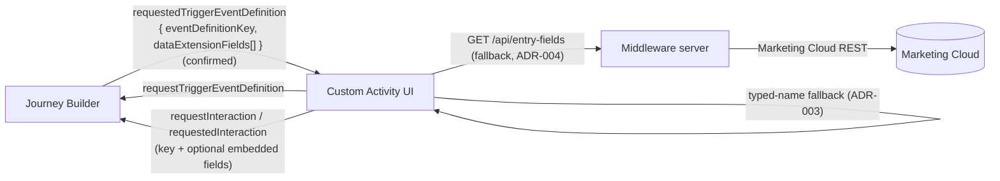
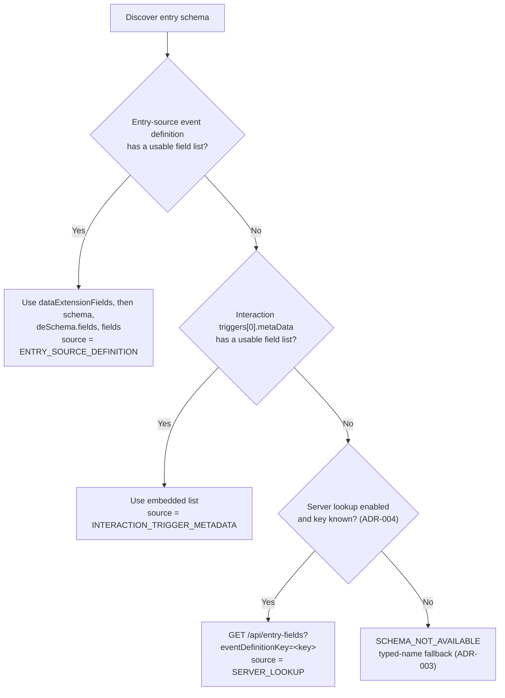

# Entry-Schema Discovery — System Design

## 1. Overview

The Custom Activity editor must know the Data Extension (DE) field list of the
Journey entry source to let the designer map template parameters to fields.
Discovery obtains the entry `eventDefinitionKey` and the DE field list from
Journey Builder through Postmonger, with server-side and typed-name
fallbacks.

This document reflects **ADR-005**: the entry-source event definition
(`requestedTriggerEventDefinition.dataExtensionFields`) is now the primary,
journey-verified source of DE fields.

## 2. Requirements

### Functional

- F1: Discover the `eventDefinitionKey` of the Journey entry source.
- F2: Discover the DE field list (names, types, ordering) when the entry
  source is a Data Extension.
- F3: Populate the normalized field catalog used by mapping, auto-matching
  and validation.
- F4: Detect when the entry source changed since the activity was saved.
- F5: Keep the editor usable when discovery fails (static mappings only).

### Non-functional

- NF1: No customer data leaves the browser — metadata only.
- NF2: Discovery must not block the editor forever (deadline-based, retryable).
- NF3: Standalone development must exercise the same code path as production.
- NF4: Malformed payloads must never crash the UI; they degrade to
  `SCHEMA_NOT_AVAILABLE`.

## 3. Architecture



### Components

| Component | File | Responsibility |
|---|---|---|
| Bridge | `public/js/postmonger-client.js` | Sole owner of Postmonger events; exposes `requestTriggerEventDefinition()` / `onRequestedTriggerEventDefinition()` |
| Standalone adapter | `public/js/standalone-adapter.js` | Mimics the bridge outside Journey Builder; answers with the fixture in the confirmed shape |
| Provider | `public/js/schema/entry-schema-provider.js` | Orchestrates requests, deadlines, caching, retry, merge priority, server fallback |
| Normalizer | `public/js/schema/entry-schema-normalizer.js` | Only module that knows Journey Builder payload shapes; converts raw payloads to the field model |
| Server lookup | `public/js/schema/server-field-lookup.js` | Client for `GET /api/entry-fields` (ADR-004) |
| Fixture | `public/fixtures/entry-schema.fixture.json` | Standalone entry-schema data (never loaded in real mode) |

## 4. Discovery Priority Ladder



Notes:

- The **key** is taken from the interaction `triggers[0].metaData` first,
  then from the entry-source definition (unchanged).
- The **field list** is taken from the entry-source definition first
  (ADR-005), then from the interaction metadata.
- A field list is "usable" when it normalizes to at least one valid field
  (`normalizeFieldList` returns `valid: true`).
- The server lookup runs only when the merged result is
  `SCHEMA_NOT_AVAILABLE` and the key is known; it never invents fields.

## 5. Sequence

```mermaid
sequenceDiagram
    participant UI as Custom Activity UI
    participant BR as Postmonger bridge
    participant JB as Journey Builder
    participant SRV as Middleware server

    UI->>BR: initialize()
    BR->>JB: ready
    UI->>BR: prefetch() (right after initialize)
    BR->>JB: requestTriggerEventDefinition
    BR->>JB: requestInteraction
    JB-->>BR: requestedTriggerEventDefinition<br/>{ eventDefinitionKey, dataExtensionFields[] }
    JB-->>BR: requestedInteraction<br/>{ triggers[0].metaData }
    BR-->>UI: onRequestedTriggerEventDefinition(payload)
    BR-->>UI: onRequestedInteraction(payload)
    UI->>UI: normalize + merge (entry source preferred)

    alt Entry-source fields usable (confirmed path)
        UI->>UI: catalog from dataExtensionFields
    else Interaction metadata has fields
        UI->>UI: catalog from triggers[0].metaData
    else No field list, key known, lookup enabled
        UI->>SRV: GET /api/entry-fields?eventDefinitionKey=&lt;key&gt;
        SRV-->>UI: { fields[] }
        UI->>UI: catalog from server fields
    else Nothing usable
        UI->>UI: SCHEMA_NOT_AVAILABLE -> typed-name fallback
    end
```

Timing rules (unchanged from the current provider):

- Both requests are sent at `prefetch()` and again lazily by `discover()` if
  no response was cached.
- Each awaited request waits at most `DISCOVERY_RESPONSE_TIMEOUT_MS` (8 s);
  the entry-source wait is capped at `ENTRY_SOURCE_GRACE_MS` (1.5 s) once the
  interaction already supplied a valid key.
- Late responses are cached and reused by the next discovery; a failed
  discovery clears the cache so Retry re-asks Journey Builder.

## 6. Payload Shapes

### 6.1 Confirmed: entry-source event definition (ADR-005)

Response to `requestTriggerEventDefinition` — **journey-verified**:

```json
{
  "eventDefinitionKey": "ORDER_ENTRY_EVENT",
  "dataExtensionFields": [
    { "name": "CustomerId", "type": "Text", "ordinal": 0 },
    { "name": "CustomerName", "type": "Text", "ordinal": 1 },
    { "name": "MobilePhone", "type": "Phone", "ordinal": 2 },
    { "name": "OrderAmount", "type": "Decimal", "ordinal": 3 }
  ]
}
```

> Per-field attribute names (`name`, `type`, ...) follow the existing
> normalization rules; the exact attribute set observed live must still be
> captured into a fixture (change spec, step 6).

Other field-list candidates accepted in the same payload, in order:
`schema`, `deSchema.fields`, `fields` (kept for compatibility).

### 6.2 Interaction (`requestedInteraction`)

```json
{
  "triggers": [
    {
      "key": "TRIGGER",
      "metaData": {
        "eventDefinitionKey": "ORDER_ENTRY_EVENT",
        "deSchema": { "fields": [] }
      }
    }
  ]
}
```

Only `triggers[0].metaData` is read. Optional embedded lists:
`metaData.schema`, `metaData.deSchema.fields`.

### 6.3 Normalized field model

Each catalog field (from `field-catalog-model.js`):

```json
{
  "id": "CustomerId",
  "name": "CustomerId",
  "label": "Customer Id",
  "dataType": "TEXT",
  "source": "ENTRY_EVENT",
  "bindingPath": "CustomerId",
  "nullable": true,
  "ordinal": 0
}
```

## 7. Failure Modes

| Condition | Behavior | Recovery |
|---|---|---|
| JB never answers `requestedTriggerEventDefinition` | Waiter times out (grace 1.5 s when key known); falls through the ladder | Retry re-asks |
| Neither payload has a field list | `SCHEMA_NOT_AVAILABLE`; server lookup attempted when key known | Retry; typed-name fallback |
| Server lookup disabled / empty / unreachable | Falls back to typed-name fallback (ADR-003) | Configure `SFMC_REST_*` |
| Malformed payload | Normalizer returns invalid; cached payload rejected | Retry clears cache |
| Postmonger SDK missing (embedded page) | `POSTMONGER_UNAVAILABLE`; editor usable with static values | Fix deployment |

## 8. Monitoring & Debugging

- `?debugSchema=true` logs the normalized result; payload **structure** is
  always logged (property names/types only, never values).
- Discovery source is exposed per run (`interactionTriggerMetadata`,
  `entrySourceDefinition`, `serverLookup`, `none`) and surfaced in the
  schema status panel and logs.
- A regression test asserts the confirmed path resolves
  `dataExtensionFields` into the catalog with `source =
  ENTRY_SOURCE_DEFINITION`.

## 9. Risks & Mitigations

See ADR-005 "Risks". Primary: per-field attribute shape not yet
fixture-captured; mitigation is a captured live fixture + normalizer test
before release.